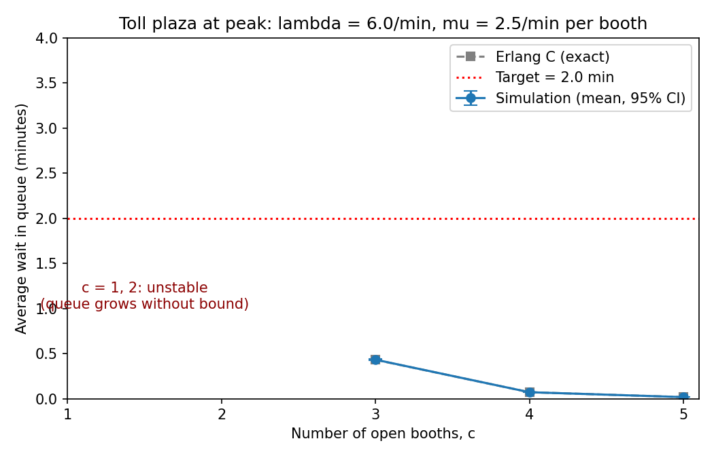

# Toll Plaza Queue Simulation

A discrete-event simulation of cars queueing at an expressway toll plaza, used to find how many booths must be open at peak time to keep the average wait under two minutes.

**[Live demo](https://YOUR-GITHUB-USER.github.io/toll-plaza-queue-sim/)** · [](https://colab.research.google.com/github/YOUR-GITHUB-USER/toll-plaza-queue-sim/blob/main/notebook/toll-plaza-queue-sim.ipynb)


## The problem

At peak time, cars reach an expressway toll plaza at random, and each booth can serve only one car at a time. Too few open booths and a queue builds up; too many and staff and equipment sit idle. The operator needs a defensible number.

The question this simulation answers is: **how many toll booths must be open at peak time to keep the average waiting time under two minutes?** The model uses illustrative peak-hour inputs of 6 cars arriving per minute and 2.5 cars served per minute by each booth. The method carries over directly to real traffic counts and service times.

## Quick start

**Notebook:** click the *Open in Colab* badge above, then *Runtime → Run all*. Everything installs and runs in about 2 minutes on a free runtime.

**Web demo:** open the [live demo](https://YOUR-GITHUB-USER.github.io/toll-plaza-queue-sim/), or download this repository and double-click `docs/index.html`.

**Run locally (optional):**

```bash
pip install -r requirements.txt
jupyter notebook notebook/toll-plaza-queue-sim.ipynb
```

## Using the demo

Sliders set the arrival rate, the service rate per booth, the number of open booths and the animation speed. Press **Start** to watch cars arrive, queue, get served and leave; car colour shows how long each car waited. Live statistics compare the simulated average wait with the exact theoretical value, and **Run check** repeats the verification in your browser. Full guide: [USER_GUIDE.md](USER_GUIDE.md).

## Model and mathematics

The plaza is an M/M/c queue: Poisson arrivals at rate $\lambda$, exponential service at rate $\mu$ per booth, $c$ booths and one first-come-first-served line. The key quantity is the traffic intensity

$$\rho = \frac{\lambda}{c\mu},$$

and a steady state exists only when $\rho < 1$. The exact mean wait in the queue is the Erlang C result,

$$W_q = \frac{P_{\text{wait}}}{c\mu - \lambda},$$

where $P_{\text{wait}}$ is the probability that an arriving car must wait. The simulator uses next-event time advance: it keeps an event list and jumps from one arrival or departure to the next. Full derivations, assumptions and parameters: [THEORY.md](THEORY.md).

## Verification

The simulator is checked against exact queueing theory with `assert` statements in the notebook, which stop the run if simulation and theory disagree by more than 5%. In practice the agreement is much tighter:

- **One booth (M/M/1):** simulated mean wait is within 0.1% of the exact formula.
- **Several booths (M/M/c):** within 0.6% of Erlang C for 3, 4 and 5 booths at the peak-hour inputs, and within 0.8% for a second, different system.
- **Error vs. sample size:** the simulation error falls like $1/\sqrt{n}$, with a fitted log–log slope of −0.47 against the theoretical −0.5.


## Concepts applied

This project applies next-event time-advance discrete-event simulation, inverse-transform random variate generation and Monte Carlo confidence intervals based on the law of large numbers, and verifies the simulator against analytic steady-state results. Thinning is used to generate arrivals whose rate changes over time.

## Results

At the peak-hour inputs, **at least 3 booths must be open.** One or two booths cannot keep up ($\rho \ge 1$), while three keep the average wait at about 0.43 minutes, well under the two-minute target.

| Open booths | $\rho$ | Average wait, simulation (95% CI) | Exact (Erlang C) |
|---|---|---|---|
| 1 | 2.40 | queue grows without bound | no steady state |
| 2 | 1.20 | queue grows without bound | no steady state |
| **3** | 0.80 | **0.43 min** (0.43 to 0.44) | 0.4315 min |
| 4 | 0.60 | 0.07 min | 0.0718 min |
| 5 | 0.48 | 0.02 min | 0.0175 min |



Three further results come from the extensions:

- **Rush hour.** With arrivals of 3, 6 and 2 cars per minute across a three-hour morning, three booths keep the rush-hour average at 0.38 min, while two booths reach 6.7 min.
- **Sensitivity.** The service rate $\mu$ matters more than the arrival rate $\lambda$: a 1% change in $\mu$ moves the average wait by about 7%, against about 6% for $\lambda$.
- **Robustness.** Three booths still suffice if arrivals are up to 10% higher than assumed. A 20% rise in arrivals, or 20% slower service, needs four.

## Limitations and future work

- Arrivals are Poisson and service times exponential, with one shared line and identical booths. Real service times (for example electronic tags) are often less variable, which would shorten waits, and drivers choose and switch lanes.
- The target is the *average* wait. A target on the worst-off cars (for example, 95% waiting under five minutes) would need a different analysis and could require more booths.
- With more time or data: estimate $\lambda$ and $\mu$ from real traffic counts and transaction times, add booth types (cash, tag, mixed) and test other service-time distributions.

## Key references

1. D. Gross, J. F. Shortle, J. M. Thompson and C. M. Harris, *Fundamentals of Queueing Theory*, 4th ed., Wiley, 2008.
2. A. M. Law, *Simulation Modeling and Analysis*, 5th ed., McGraw-Hill Education, 2015.
3. J. Banks, J. S. Carson, B. L. Nelson and D. M. Nicol, *Discrete-Event System Simulation*, 5th ed., Prentice Hall, 2010.
4. P. A. W. Lewis and G. S. Shedler, "Simulation of nonhomogeneous Poisson processes by thinning," *Naval Research Logistics Quarterly*, 26(3), 403–413, 1979. https://doi.org/10.1002/nav.3800260304
5. A. K. Erlang, "Solution of some problems in the theory of probabilities of significance in automatic telephone exchanges," *Post Office Electrical Engineers' Journal*, 10, 189–197, 1917.

Full list: [REFERENCES.md](REFERENCES.md).

## AI assistance

Developed with the help of AI coding and writing assistants. All code was reviewed, run and verified by the author.

## Licence and credits

Code: [MIT](LICENSE). Data: none; all inputs are illustrative parameters stated in the notebook. Software: NumPy, SciPy and Matplotlib.
